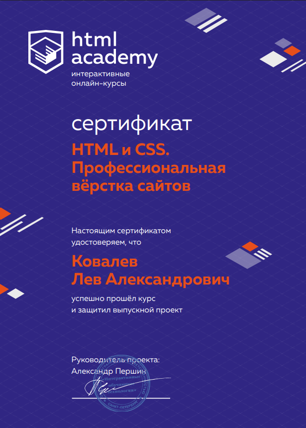
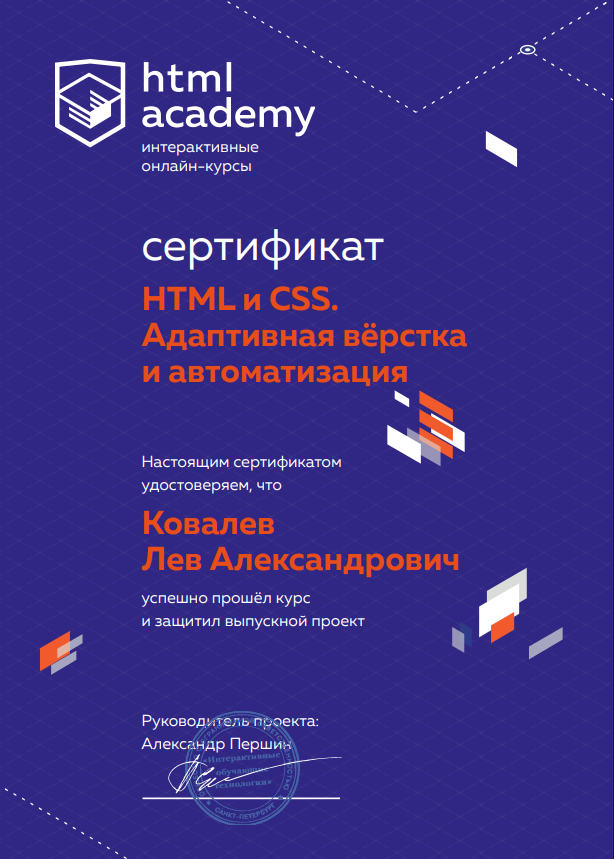
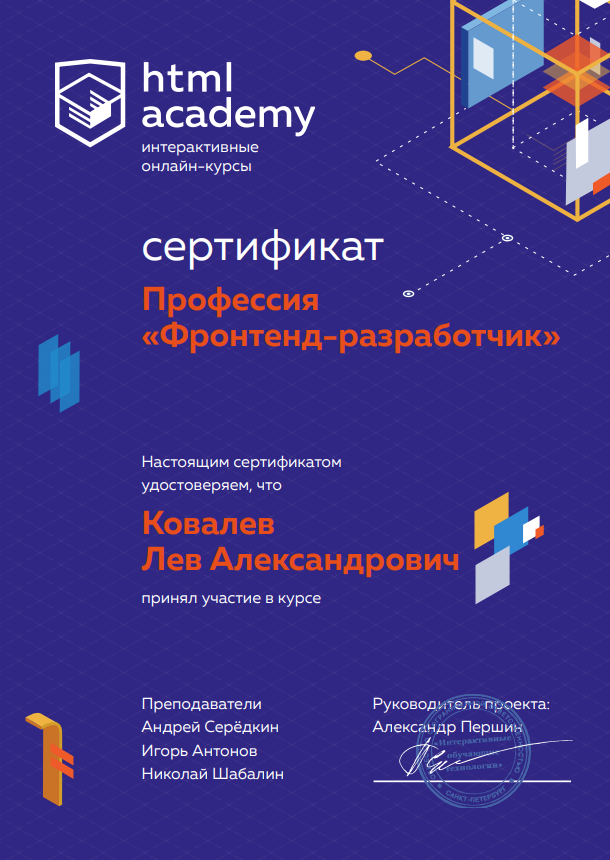

# Привет! Я Лев Ковалев 👋

Я начинающий Frontend-разработчик. Имею практический опыт создания адаптивных сайтов и веб-приложений, прошел обучение по профессии «Фронтенд-разработчик» в HTML Academy.

## 🛠 Мой стек
HTML5, CSS3 (SCSS, БЭМ), JavaScript (ES6+), Gulp, Webpack, Git.

## 🚀 Мои проекты
Ниже представлены проекты, выполненные в рамках обучения. Все они опубликованы и доступны для просмотра.

1. **[The Great Journey](https://github.com/LioNkek/TheGreatJourney)** — Веб-приложение для путешествий (JS, Webpack).
2. **[Keksogram](https://github.com/LioNkek/keksogram)** — Социальная сеть для фото (JS, чистая верстка).
3. **[Travel](https://github.com/LioNkek/Travel)** — Адаптивный сайт для туров (HTML, SCSS, Gulp).
4. **[Drink2Go](https://github.com/LioNkek/Drink2Go)** — Интернет-магазин напитков (HTML, SCSS, Gulp).
5. **[Cat Energy](https://github.com/LioNkek/cat-energy)** — Интернет-магазин корма (HTML, SCSS, Gulp).
6. **[Sedona](https://github.com/LioNkek/Sedonalewk)** — Сайт для туристов (HTML, CSS, JS).

## 📜 Сертификаты

  
  
  

## 📫 Как со мной связаться
- **Email:** lion.gg.k@gmail.com
- **Telegram:** [@lev_kovalev90](https://t.me/lev_kovalev90)
